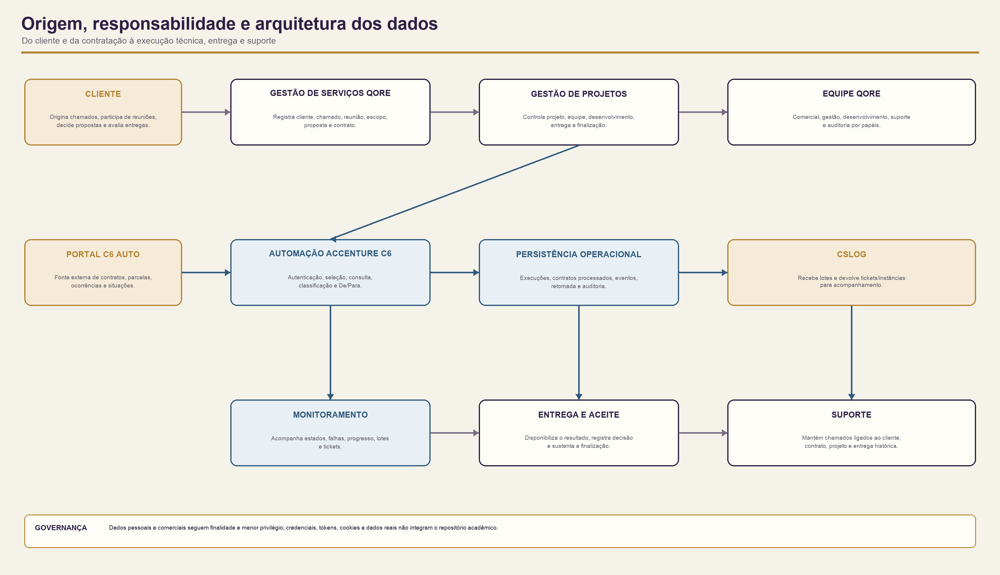
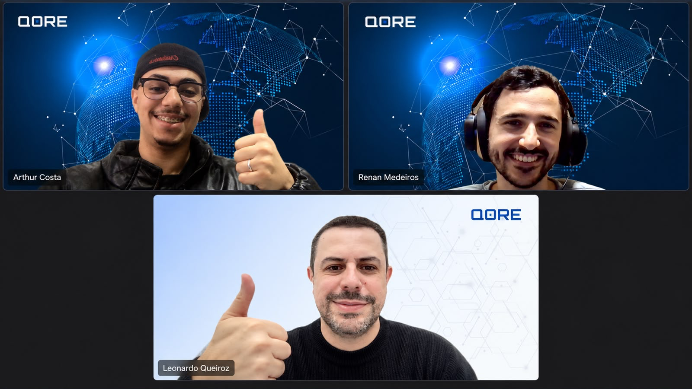
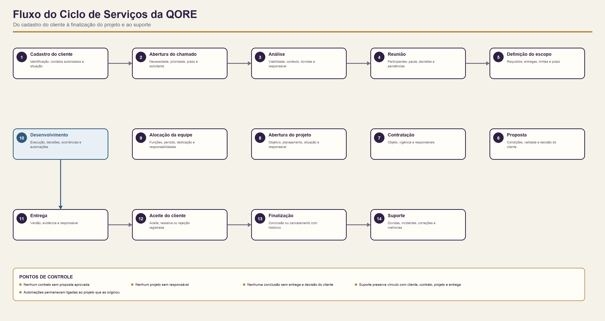
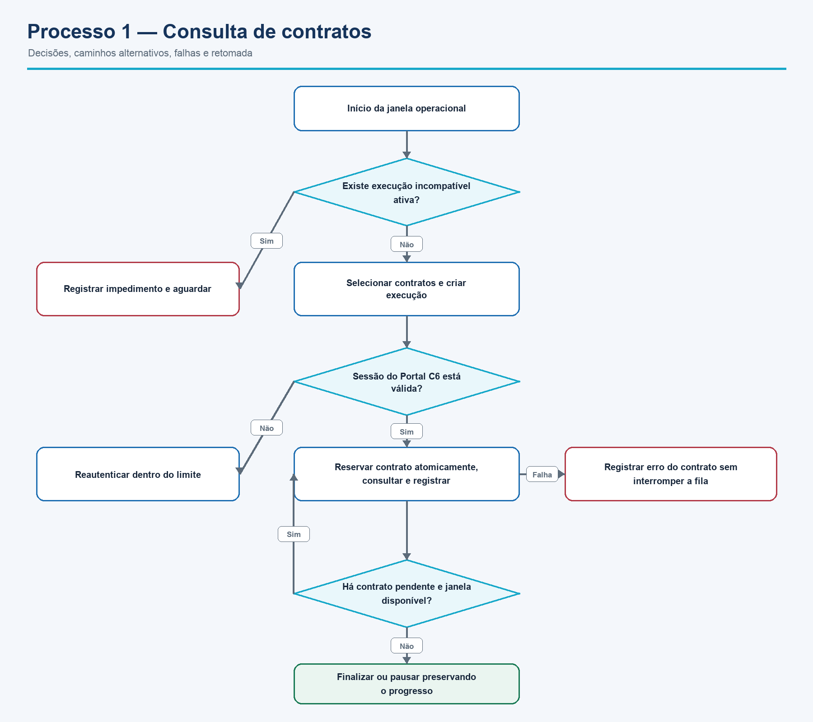
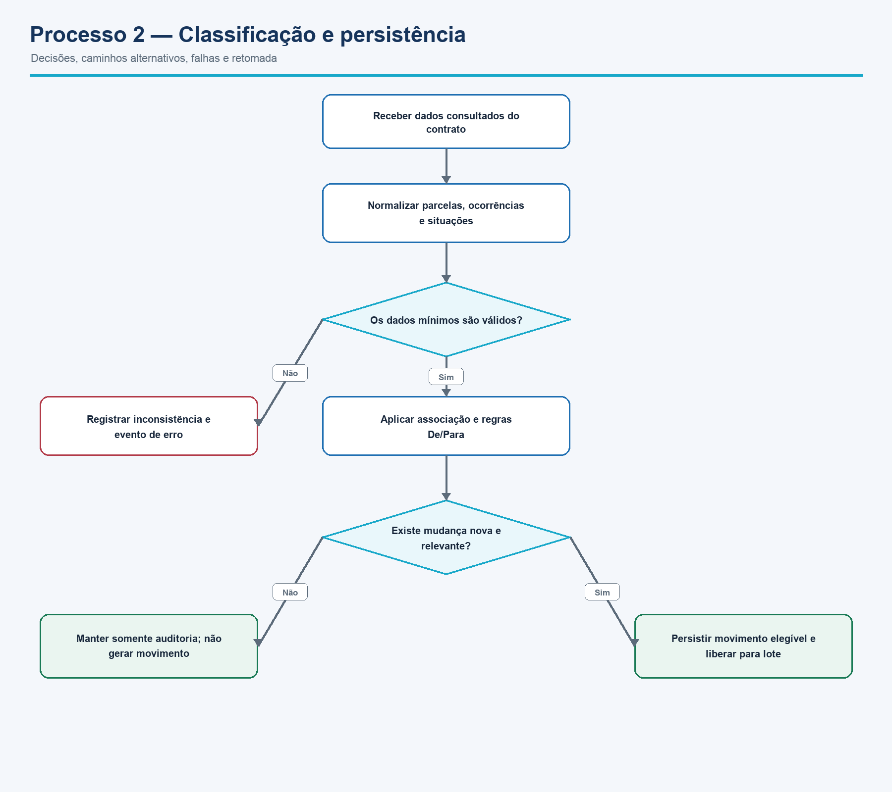
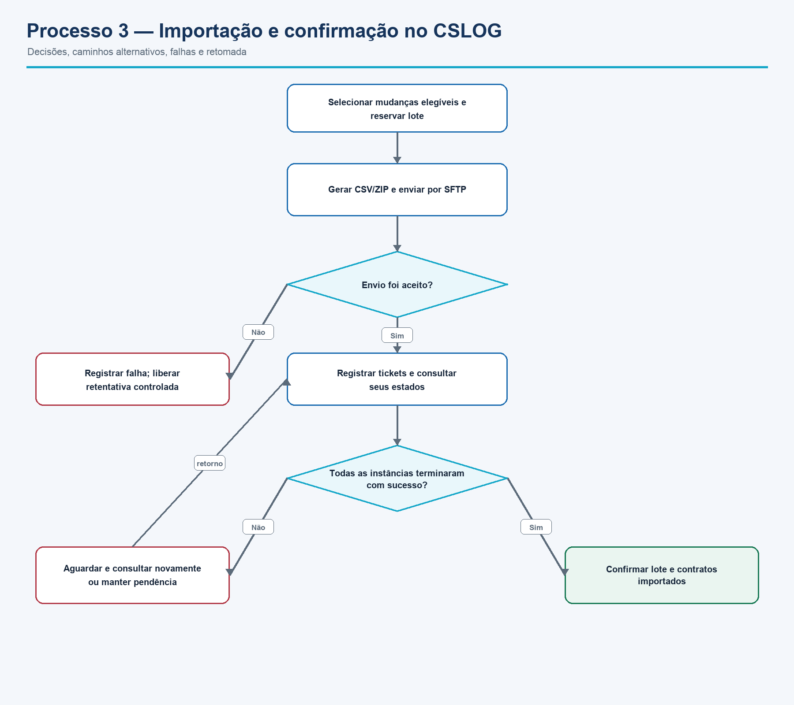
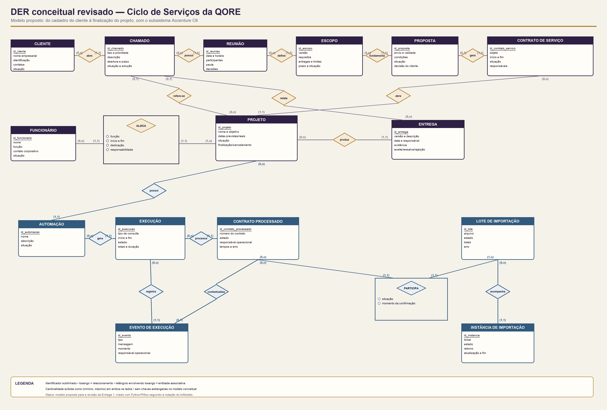

# Entrega 1 — Modelo Conceitual (DER)

| Informação | Identificação |
|---|---|
| Instituição | Universidade Cidade de São Paulo — UNICID |
| Curso | Ciência da Computação |
| Disciplina | Modelagem de Banco de Dados |
| Professor | Cid Rodrigues |
| Local e ano | São Paulo — SP, 2026 |

## Integrantes

| Integrante | RGM |
|---|---:|
| Arthur Costa | 46677259 |
| Felipe Pereira Vescia | 46825576 |
| Roginer Haiz dos Santos | 47632160 |

---

# Título

## Modelagem de Banco de Dados para Gestão do Ciclo de Serviços e Automações da QORE Tecnologia

## Introdução

### Problema

A QORE Tecnologia atende diferentes clientes e mantém mais de 20 projetos ativos. O ciclo de um serviço começa no cadastro do cliente e na abertura de um chamado com a necessidade, passa por análise, reunião, definição do escopo, proposta, contratação, abertura do projeto, desenvolvimento e entrega, e termina com o aceite e a finalização formal do projeto. Com aproximadamente 7 clientes ativos e mais de 100 chamados mensais, manter essas informações separadas dificulta rastrear a origem da demanda, as decisões tomadas, os responsáveis, a situação do projeto e o resultado entregue.

Dentro desse ciclo, a automação Accenture C6 é um caso concreto de projeto técnico: consulta contratos no Portal C6 Auto, interpreta parcelas e ocorrências, aplica regras de classificação e envia ao CSLOG apenas mudanças relevantes. Sem controle estruturado, esse subprocesso também fica sujeito a duplicidade de movimentos, perda do ponto de retomada, dificuldade de identificar falhas e ausência de rastreabilidade entre execução, contrato processado e lote importado.

### Objetivo geral

Modelar conceitualmente um banco de dados capaz de registrar e acompanhar o ciclo completo dos serviços da QORE Tecnologia, desde o cadastro do cliente até a finalização do projeto, mantendo a automação Accenture C6 como um subsistema técnico ligado ao projeto, às execuções, aos contratos processados e às importações destinadas ao CSLOG.

### Objetivos específicos

- representar o cadastro de clientes e a abertura de chamados ou solicitações;
- acompanhar análise, reunião, escopo, proposta, contratação e abertura do projeto;
- registrar responsáveis, alocações, desenvolvimento, entrega, aceite e finalização do projeto;
- manter o suporte ligado ao cliente, ao contrato e ao histórico do projeto;
- preservar a rastreabilidade técnica da automação Accenture C6 entre execução, contrato processado, evento e lote importado;
- identificar requisitos funcionais, requisitos não funcionais e regras de negócio do ciclo organizacional e do subsistema técnico;
- reconhecer entidades, atributos, relacionamentos e cardinalidades;
- representar o modelo em um Diagrama Entidade-Relacionamento na notação exigida;
- justificar as decisões de inclusão, exclusão e abstração adotadas.

### Delimitação

O modelo representa o ciclo de serviços da QORE Tecnologia **desde o cadastro do cliente até a finalização formal do projeto**. O suporte pode ocorrer durante o desenvolvimento ou depois da entrega, sempre preservando o vínculo com o cliente, o contrato e o projeto histórico. A automação Accenture C6 integra esse ciclo como solução desenvolvida em um projeto e mantém seu detalhamento operacional de execução, eventos, contratos processados e importações.

O banco acadêmico não reproduz dados sigilosos dos clientes, valores comerciais reais, credenciais, respostas brutas do portal nem todo o conteúdo de cada linha enviada ao CRM. Processos de faturamento, compras, fornecedores, licenças e infraestrutura ainda dependem de confirmação específica da organização antes de serem apresentados como fatos. `PARCELA`, `OCORRENCIA`, `WORKER` e `MOVIMENTO_CSLOG` continuam avaliados como detalhes técnicos do subsistema, cuja permanência ou exclusão será justificada no modelo conceitual revisado.

---

## Desenvolvimento

### Caracterização da Organização

#### Nome e natureza da organização

A organização escolhida foi a **QORE Tecnologia**, empresa privada brasileira do setor de tecnologia da informação. A empresa atua com infraestrutura de TI, automação de processos, desenvolvimento de sistemas, suporte técnico, telecomunicações, analytics, Control Desk e segurança da informação.

#### Contexto e porte

A QORE está sediada em São Caetano do Sul, São Paulo, e possui aproximadamente **50 funcionários**. No momento do levantamento, mantém aproximadamente **7 clientes ativos**, **mais de 20 projetos ativos** e recebe **mais de 100 chamados por mês**. A operação envolve atendimento ao cliente, análise de necessidades, elaboração de escopo e proposta, contratação, gestão de projetos, desenvolvimento, entrega e suporte, além de automação, integração de sistemas, monitoramento e tratamento de dados operacionais.

No processo Accenture C6, a automação é configurada para trabalhar com um Terminal 0 coordenador e até 51 workers de processamento. As execuções ocorrem em janelas recorrentes durante a semana e o fim de semana, processando filas de contratos e lotes de importação com múltiplos tickets.

#### Problemas e necessidades identificados

Os problemas foram codificados para permitir rastreabilidade posterior entre necessidade, modelo de dados e consultas gerenciais:

| ID | Problema ou necessidade |
|---|---|
| P01 | As informações do cliente, do chamado inicial e do projeto precisam permanecer vinculadas durante todo o ciclo do serviço. |
| P02 | A organização precisa rastrear a evolução da necessidade desde a análise e a reunião até o escopo, a proposta e a contratação. |
| P03 | Com mais de 20 projetos ativos, é necessário acompanhar situação, responsáveis, equipe, desenvolvimento, entrega, aceite e finalização. |
| P04 | Com mais de 100 chamados mensais, é necessário identificar cliente, tipo, prioridade, situação, responsável, prazo e solução de cada atendimento. |
| P05 | As entregas e o aceite do cliente precisam ser registrados para que a finalização do projeto seja formal e auditável. |
| P06 | Projetos que produzem automações precisam ligar o contexto organizacional às execuções, aos contratos processados, aos eventos e às importações técnicas. |
| P07 | A automação Accenture C6 precisa consultar e classificar grande quantidade de contratos sem duplicar reservas ou movimentos. |
| P08 | Uma execução interrompida precisa preservar concluídos, retomar pendentes e manter o histórico das falhas. |
| P09 | Um lote de importação precisa ser acompanhado até a conclusão de todos os tickets devolvidos pelo CSLOG. |
| P10 | Dados de clientes, contratos, credenciais e respostas operacionais precisam permanecer protegidos e acessíveis somente a pessoas autorizadas. |

A necessidade central passa a ser a rastreabilidade completa: **quem é o cliente, qual necessidade originou o serviço, o que foi acordado, qual projeto foi aberto, quem participou, o que foi entregue, quando o projeto foi finalizado e, nos projetos com automação, como cada execução técnica se comportou**.

#### Origem da solicitação e responsabilidades

Segundo o levantamento de campo informado pelo responsável técnico, a necessidade foi apresentada por **Letícia Ferrari**, Gerente Executiva da Carteira C6 e funcionária da **DNR Teleserviços**, cliente da QORE. A QORE recebeu e registrou a solicitação e designou **Arthur Costa**, integrante de sua equipe, como responsável pelo desenvolvimento da automação.

Essa cadeia distingue três papéis que não devem ser confundidos:

| Papel | Participante | Responsabilidade no projeto |
|---|---|---|
| Solicitante operacional | Letícia Ferrari — DNR Teleserviços | Apresentar a necessidade relacionada à Carteira C6. |
| Organização executora | QORE Tecnologia | Receber, registrar, desenvolver e acompanhar a solução. |
| Responsável técnico | Arthur Costa — QORE | Desenvolver a automação e estruturar seu controle de dados. |
| Sistema de origem | Portal C6 Auto utilizado no contexto da operação Accenture | Disponibilizar contratos, parcelas, ocorrências, pagamentos, fases e situações para consulta. |
| Sistema de destino | CSLOG | Receber mudanças classificadas e devolver tickets de acompanhamento. |

O trabalho não afirma vínculo contratual direto da Accenture com a QORE. No recorte documentado, “Accenture C6” identifica o contexto operacional e o portal consultado; a solicitação descrita partiu da representante da DNR Teleserviços.

#### Justificativa da escolha

A QORE foi escolhida porque é uma organização real, acessível ao grupo e possui um ciclo de serviços com complexidade adequada à disciplina. O caso reúne clientes, chamados, reuniões, escopos, propostas, contratos, projetos, funcionários, entregas e suporte. A automação Accenture C6 acrescenta um caso técnico concreto com concorrência entre workers, estados de execução, tratamento de erros, relacionamento muitos-para-muitos e integração com sistema externo. Assim, o modelo pode representar tanto a gestão organizacional quanto a rastreabilidade operacional de uma solução entregue.

#### Contexto do caso e termos utilizados

- **Accenture C6:** nome adotado neste trabalho para a automação executada pela QORE no processo de consulta e acompanhamento de contratos da operação Accenture vinculada ao C6. A automação acessa o Portal C6 Auto, organiza filas, consulta contratos e prepara mudanças relevantes para a etapa de importação.
- **Portal C6 Auto:** sistema de origem consultado pela automação. Nele ficam as informações de contratos, parcelas, ocorrências, pagamentos, fases e situações usadas na classificação operacional.
- **CSLOG:** sistema de destino que recebe, por importação, as atualizações produzidas após a consulta e a classificação. No recorte acadêmico, ele é tratado como um sistema externo; seu banco interno não faz parte do modelo.
- **Ticket:** protocolo devolvido pelo CSLOG para acompanhar uma importação. Um mesmo lote pode gerar mais de um ticket, motivo pelo qual o modelo possui a entidade `INSTANCIA_IMPORTACAO`.
- **Worker:** unidade paralela de processamento que reserva e consulta contratos. Os workers aumentam a capacidade da execução, mas não possuem cadastro ou ciclo de vida próprio no recorte conceitual.
- **Heartbeat:** sinal periódico de atividade de um worker. A ausência do sinal dentro do limite permite identificar uma unidade inativa e devolver o contrato à fila com segurança.
- **De/Para:** conjunto de regras que traduz situações, ocorrências e estados encontrados no portal para a classificação operacional esperada no processo.

#### Origem e linhagem dos dados

| Etapa | Origem | Dados utilizados | Transformação ou controle | Destino |
|---|---|---|---|---|
| Atendimento | Cliente e equipe QORE | Cadastro, solicitante, necessidade, prioridade, prazo e responsáveis | Qualificação, análise e registro das decisões | `CLIENTE`, `CHAMADO` e `REUNIAO` |
| Comercialização | Chamado e reunião | Requisitos, entregas, limites, condições e decisão do cliente | Versionamento do escopo, emissão da proposta e formalização | `ESCOPO`, `PROPOSTA` e `CONTRATO_SERVICO` |
| Execução do serviço | Contrato e equipe QORE | Objetivo, planejamento, participantes, progresso e artefatos | Abertura, alocação, desenvolvimento e acompanhamento | `PROJETO`, `FUNCIONARIO` e `ALOCACAO_PROJETO` |
| Entrega, finalização e suporte | Projeto e cliente | Versão, evidência, avaliação, pendências e solução | Aceite, ressalva ou rejeição; encerramento e atendimento posterior | `ENTREGA`, `PROJETO` e `CHAMADO` |
| Formação da fila | Banco/base operacional de origem | Identificadores de contratos elegíveis e critérios da fila | Prioridade, fase, situação e exclusão entre filas | `EXECUCAO` e `CONTRATO_PROCESSADO` no SQLite |
| Consulta | Portal C6 Auto | Contrato, parcelas, ocorrências, pagamentos, fases e situações | Autenticação, validação da resposta e normalização | Contexto operacional do contrato |
| Classificação | Dados normalizados da consulta | Estados e ocorrências associados às parcelas | Regras De/Para e identificação de mudança funcional | Resultado do contrato e eventos de auditoria |
| Persistência | Automação QORE | Estados, tempos, contagens, mensagens e decisões | Unicidade, reserva atômica, heartbeat e retomada | SQLite operacional |
| Preparação da integração | Mudanças elegíveis persistidas | Contratos e movimentos ainda não confirmados | Deduplicação, reserva do lote e geração de CSV/ZIP | Arquivo de importação |
| Envio | Arquivo CSV/ZIP | Mudanças classificadas | Transferência SFTP e validação do retorno | CSLOG |
| Acompanhamento | CSLOG | Ticket-base, instâncias, estados e mensagens | Consulta periódica até estado terminal | `LOTE_IMPORTACAO` e `INSTANCIA_IMPORTACAO` |

Os dados operacionais são originados nos sistemas externos; o banco proposto registra a execução, a rastreabilidade e o resultado da transformação. Ele não se apresenta como fonte mestre dos contratos do Banco C6.

#### Evidências da organização e da pesquisa de campo

- **Site institucional:** [QORE Tecnologia](https://www.qoretecnologia.com.br/)
- **LinkedIn institucional:** [QORE Tecnologia](https://br.linkedin.com/company/titectecnologia)
- **Endereço divulgado no site oficial:** R. Niterói, 62 — São Caetano do Sul, SP.
- **Telefone divulgado:** (11) 4081-5292.
- **E-mail divulgado:** contato@qoretecnologia.com.br.
- **Responsável consultado:** Leonardo Queiroz — CEO.
- **Participantes da consulta:** Leonardo Queiroz — CEO; Renan Medeiros — Tech Lead; Arthur Costa — Dev.
- **Forma de pesquisa:** reunião remota, observação do processo, leitura da documentação, inspeção de código e análise controlada do banco local.

> A fotografia é utilizada exclusivamente como evidência acadêmica da empresa consultada e das pessoas que participaram do levantamento.

#### Correções realizadas a partir da avaliação da Entrega 1

| Apontamento da correção | O que mudou no trabalho | Por quê |
|---|---|---|
| Os processos cobriam somente 30% do ciclo organizacional. | O escopo foi ampliado do cadastro do cliente até a finalização do projeto, incluindo chamado, análise, reunião, escopo, proposta, contratação, projeto, equipe, entrega, aceite e suporte. | A automação é um subsistema de um serviço prestado pela QORE e não representa sozinha os dados da organização. |
| A contratação aparecia apenas como origem da automação. | O ciclo passou a registrar proposta, aprovação, contrato de serviço e abertura do projeto. | É necessário explicar como uma necessidade aceita se transforma em trabalho contratado. |
| Atendimento e Control Desk estavam ausentes. | Chamados foram incorporados antes, durante e depois do projeto. | A organização recebe mais de 100 chamados mensais e precisa rastrear prioridade, responsável, situação e solução. |
| Alocação de equipe e horas por projeto estava ausente. | O modelo passou a prever funcionário e alocação vinculados ao projeto. | Com mais de 20 projetos ativos, é necessário conhecer responsáveis e participantes de cada iniciativa. |
| As regras de negócio cobriam apenas 63% do cenário esperado. | Foram preservadas as regras técnicas e adicionadas regras de cliente, chamado, proposta, contratação, projeto, entrega, aceite, suporte e proteção de dados. | As restrições precisam cobrir o ciclo organizacional, não somente a execução da automação. |
| O dicionário de dados não atendia ao formato completo. | Sua reconstrução foi definida para incluir atributos organizacionais, cardinalidades, domínios, convenções, integridade, acesso e LGPD. | O documento anterior descrevia somente sete entidades técnicas e três aspectos por atributo. |
| O DER usava caixas e setas, cardinalidade incompleta em um dos lados e não continha entidades do negócio. | O DER foi refeito na notação do brModelo, com participações mínima e máxima dos dois lados e entidades organizacionais conectadas ao subsistema técnico. | A notação e o escopo anteriores não representavam o ciclo completo solicitado. |
| `CLIENTE`, `CONTRATO/PROJETO` e `FUNCIONARIO` estavam ausentes. | Essas entidades passam a integrar o núcleo obrigatório do modelo revisado. | Elas possuem identidade e ciclo de vida próprios e sustentam o fluxo confirmado pela organização. |
| `CHAMADO/SOLICITACAO` e registro de entrega eram ausentes. | Chamado, entrega e aceite foram incorporados ao ciclo. | O início, o resultado e a finalização do projeto precisam ser comprováveis. |
| Faturamento, fornecedores, licenças e infraestrutura não estavam documentados. | Permanecem identificados como pontos de confirmação antes de integrar o modelo como fatos. | O trabalho não deve inventar processos, regras ou dados que ainda não foram confirmados pela organização. |

---

### Processos de Negócio

#### Ciclo organizacional dos serviços

| Etapa | Entrada e dados envolvidos | Atividades principais | Saída |
|---|---|---|---|
| Cadastro do cliente | Nome empresarial, identificação, contatos e situação | Registrar e manter os dados necessários ao relacionamento | Cliente ativo e identificável |
| Abertura do chamado | Cliente, solicitante, descrição, tipo, prioridade, data e anexos autorizados | Registrar a necessidade e encaminhar para análise | Chamado aberto e rastreável |
| Análise da necessidade | Chamado, contexto, restrições e resultado esperado | Avaliar viabilidade, esclarecer dúvidas e identificar participantes | Necessidade qualificada |
| Agendamento e reunião | Cliente, participantes, data, horário, pauta e canal | Discutir a necessidade e registrar decisões e pendências | Reunião realizada e informações para o escopo |
| Definição do escopo | Requisitos, entregas, limites, premissas, prazo e responsáveis | Consolidar o que será realizado e o que fica fora | Escopo versionado para avaliação |
| Elaboração da proposta | Escopo, prazo, condições e validade | Preparar, enviar e acompanhar aprovação ou rejeição | Proposta com situação registrada |
| Contratação | Proposta aprovada, cliente, objeto, vigência e responsáveis | Formalizar a prestação do serviço | Contrato de serviço válido |
| Abertura do projeto | Contrato, nome, objetivo, datas, situação e responsável | Criar o projeto e organizar sua execução | Projeto aberto e ligado ao cliente e ao contrato |
| Alocação da equipe | Projeto, funcionário, função, período e dedicação | Designar responsáveis e participantes | Equipe do projeto identificada |
| Desenvolvimento | Projeto, tarefas, requisitos, decisões e artefatos | Implementar, acompanhar progresso e registrar ocorrências | Solução pronta para entrega |
| Entrega e aceite | Projeto, versão, data, responsável, evidência e avaliação do cliente | Disponibilizar o resultado e registrar aceite, ressalva ou rejeição | Entrega formalmente avaliada |
| Finalização do projeto | Entregas aceitas, pendências, data, situação e responsável | Conferir conclusão, registrar resultado ou cancelamento e encerrar o ciclo | Projeto concluído ou cancelado com histórico |
| Suporte | Cliente, projeto, entrega, chamado, prioridade e solução | Atender dúvida, incidente, correção ou melhoria | Atendimento resolvido ou encaminhado |

#### Subprocessos técnicos da automação Accenture C6

| Processo | Entrada | Atividades principais | Saída |
|---|---|---|---|
| Consulta de contratos | Tipo de fila, janela, limite, workers e contratos elegíveis | Seleção, autenticação, reserva, consulta e registro | Contratos finalizados, erros, métricas e eventos |
| Classificação e persistência | Parcelas, ocorrências, pagamentos, fases e situações | Normalização, associação ocorrência-parcela, De/Para e deduplicação | Status operacional, auditoria e movimento elegível |
| Importação no CSLOG | Movimentos pendentes e contratos associados | Reserva do lote, geração de CSV/ZIP, envio SFTP e consulta de tickets | Lote concluído ou erro recuperável |
| Monitoramento e retomada | Estados persistidos, heartbeats e eventos | Cálculo de totais, detecção de worker inativo e retomada | Visibilidade operacional sem repetir concluídos |

#### Processos típicos ainda sujeitos a confirmação

Faturamento e recebimento, compras, fornecedores, licenças e infraestrutura foram apontados na correção como processos organizacionais prováveis. Eles não são apresentados como confirmados nesta revisão porque o levantamento disponível descreve o ciclo operacional do serviço, mas não informa como esses processos funcionam na QORE. Uma ampliação futura do escopo somente poderá incluir esses itens depois de confirmar como cada processo funciona na organização.

#### Agendamento operacional confirmado

| Período | Início | Sequência de consultas | Limite ou condição |
|---|---:|---|---|
| Segunda a sexta-feira | 22:00 | Prioritários com status 6–8 → ativos nas fases 0–4 → devolvidos nas fases 0–4 | 07:00 do dia seguinte |
| Segunda a sexta-feira | 07:00 | Cadastrados no dia → retornos com histórico de código 245 no dia | Até concluir |
| Sábado | 14:20 | Prioritários com status 6–8 → contratos com fase maior que 4 | Segunda-feira às 07:00 |
| Domingo | 00:00 | Somente prioritários com status 6–8 | Executa apenas se o ciclo de sábado tiver terminado |

Ao atingir um horário-limite, a execução é pausada de forma controlada: resultados concluídos são preservados e itens ainda em processamento podem retornar a `PENDENTE`. O agendador também inicia o importador CSLOG e impede sobreposição operacional incompatível.

#### Fluxograma 1 — Consulta de contratos

O fluxo explicita bloqueio por execução incompatível, autenticação, reserva atômica, erro isolado e a decisão entre continuar a fila ou pausar/finalizar.

#### Fluxograma 2 — Classificação e persistência

O fluxo separa dado inválido, auditoria sem movimento e persistência de uma mudança nova e relevante. Assim, ausência de mudança não é tratada como erro.

#### Fluxograma 3 — Importação no CSLOG

O fluxo diferencia falha de envio, acompanhamento ainda pendente e confirmação integral. Um lote não é concluído enquanto suas instâncias não atingirem o resultado esperado.

#### Integração entre os processos

O cadastro do cliente e o chamado iniciam o ciclo organizacional. A análise e a reunião produzem informações para o escopo; o escopo fundamenta a proposta; a proposta aprovada fundamenta o contrato; e o contrato permite abrir o projeto. O projeto reúne equipe, desenvolvimento, entregas, aceite e finalização. Chamados de suporte podem ocorrer durante ou depois da entrega, sempre preservando o vínculo histórico.

Nos projetos que produzem automações, a automação fica vinculada ao projeto. No caso Accenture C6, a consulta produz os dados necessários à classificação; a classificação aplica as regras De/Para e registra o histórico operacional; somente mudanças novas e relevantes tornam-se elegíveis para importação; e a importação acompanha os tickets até o estado terminal. Assim, o processo técnico permanece rastreável até o cliente, o contrato e o projeto que lhe deram origem.

---

### Proposta de Solução

#### Visão geral

Propõe-se uma solução de gestão e persistência centrada em **rastreabilidade ponta a ponta**, desde o cadastro do cliente até a finalização do projeto. O banco não deve funcionar apenas como um depósito de resultados: ele deve explicar qual necessidade iniciou o atendimento, o que foi analisado, acordado e contratado, qual projeto foi aberto, quem participou, o que foi entregue, como o cliente avaliou a entrega e quando o projeto foi encerrado.

A automação Accenture C6 permanece como subsistema de um projeto. Ela não substitui o Portal C6 Auto nem o CSLOG: registra o comportamento operacional entre esses sistemas, reduzindo duplicidade, perda de progresso e dificuldade de auditoria. O novo núcleo organizacional ligará essas informações técnicas a cliente, chamado, proposta, contrato, projeto, equipe, entrega e aceite.

#### Componentes lógicos da solução

| Componente | Responsabilidade | Dados principais envolvidos |
|---|---|---|
| Gestão de clientes | Identificar a organização atendida e seus contatos autorizados. | `CLIENTE` |
| Atendimento e levantamento | Registrar chamados, análises, reuniões e decisões. | `CHAMADO` e `REUNIAO` |
| Comercialização do serviço | Controlar escopo, proposta, aprovação e contratação. | `ESCOPO`, `PROPOSTA` e `CONTRATO_SERVICO` |
| Gestão de projetos | Abrir, acompanhar e finalizar projetos ligados ao cliente e ao contrato. | `PROJETO` |
| Equipe | Relacionar funcionários, funções, períodos e responsabilidades aos projetos. | `FUNCIONARIO` e `ALOCACAO_PROJETO` |
| Entrega e aceite | Registrar versões entregues, evidências, avaliação do cliente e encerramento. | `ENTREGA` |
| Cadastro da automação | Identificar e descrever o processo monitorado. | `AUTOMACAO` |
| Orquestração e agendamento | Abrir execuções nas janelas definidas, impedir sobreposição incompatível e aplicar horários-limite. | `EXECUCAO` |
| Processamento de contratos | Selecionar, reservar, consultar, classificar e finalizar cada item da fila. | `CONTRATO_PROCESSADO` |
| Auditoria operacional | Registrar mudanças de estado, heartbeats, retomadas, erros e decisões relevantes. | `EVENTO_EXECUCAO` |
| Gestão de importação | Agrupar contratos elegíveis, controlar o envio ao CSLOG e consolidar o resultado. | `LOTE_IMPORTACAO` e `PARTICIPACAO_LOTE` |
| Acompanhamento externo | Registrar cada ticket devolvido pelo CSLOG até seu encerramento. | `INSTANCIA_IMPORTACAO` |
| Monitoramento | Calcular indicadores a partir das entidades, sem criar uma entidade genérica e redundante de métricas. | Consultas sobre execução, contrato, evento e lote |

#### Fluxo de dados proposto

| Etapa | Entrada | Validação e regra aplicada | Persistência | Saída observável |
|---|---|---|---|---|
| 1. Disparo | Data, horário, tipo de consulta e configuração operacional | Verificar janela, ciclo anterior e ausência de execução incompatível | Criar `EXECUCAO` vinculada a `AUTOMACAO` | Execução identificada e auditável |
| 2. Formação da fila | Contratos elegíveis no banco de origem | Aplicar prioridade, fase, situação e exclusão entre filas | Criar `CONTRATO_PROCESSADO` único dentro da execução | Total da fila e itens pendentes |
| 3. Reserva | Contrato em `PENDENTE` e worker disponível | Reservar atomicamente somente um item por worker | Atualizar contrato para `PROCESSANDO` e registrar evento | Responsável e horário conhecidos |
| 4. Consulta | Sessão autenticada e número do contrato | Validar retorno, parcelas, ocorrências e consistência mínima | Atualizar quantidades, tempos e contexto do contrato | Dados prontos para classificação |
| 5. Classificação | Dados normalizados do portal | Aplicar associação ocorrência-parcela e regras De/Para | Registrar resultado e eventos relevantes | Sucesso, erro ou mudança elegível |
| 6. Seleção para importação | Mudanças funcionais produzidas | Remover conteúdo repetido e ignorar estado sem mudança relevante | Associar contratos ao lote | Conjunto idempotente para envio |
| 7. Envio ao CSLOG | Lote reservado, arquivo gerado e conexão autorizada | Garantir exclusividade da importação e validar retorno do envio | Atualizar `LOTE_IMPORTACAO` | Ticket-base e quantidade enviada |
| 8. Acompanhamento | Ticket-base e instâncias descobertas | Consultar até que todas as instâncias válidas terminem | Atualizar `INSTANCIA_IMPORTACAO` | Lote concluído ou erro recuperável |
| 9. Encerramento | Estados finais dos contratos e tickets | Conferir totais e integridade referencial | Finalizar execução e lote | Histórico completo para relatório |

#### Ciclos de vida controlados

Os estados não são apenas rótulos de tela: eles determinam quais transições são permitidas e como o processo pode ser recuperado.

| Objeto | Ciclo de vida proposto | Controle principal |
|---|---|---|
| Execução | criada → rodando → pausada ou finalizada; erro somente para interrupção técnica geral | Execução pausada conserva concluídos e pode retomar no mesmo identificador. |
| Contrato | pendente → processando → sucesso ou erro | Contrato sem heartbeat válido pode retornar a pendente; sucesso não volta automaticamente à fila. |
| Lote | processando → concluído ou erro | Apenas um lote pode permanecer com reserva de envio ativa. |
| Instância | aguardando → em processamento → concluída ou erro | O lote só é confirmado quando todas as instâncias existentes alcançam estado terminal válido. |

#### Integridade, concorrência e idempotência

Para evitar inconsistências, a proposta combina regras do banco com transações da aplicação:

1. `CONTRATO_PROCESSADO` deve ser único por execução e número do contrato;
2. a passagem de `PENDENTE` para `PROCESSANDO` deve ocorrer em transação atômica, impedindo dois workers de reservar o mesmo item;
3. `PARTICIPACAO_LOTE` deve ser única para a mesma combinação de contrato processado e lote;
4. cada número de instância e cada ticket devem ser únicos dentro do lote;
5. chaves estrangeiras devem impedir contratos, eventos, associações e instâncias órfãos;
6. a seleção para importação deve comparar o conteúdo funcional já confirmado, impedindo o reenvio de uma atualização idêntica;
7. contadores consolidados devem ser recalculáveis a partir dos registros detalhados, permitindo detectar divergências.

Essas medidas tratam dois riscos centrais do processo: **concorrência**, causada pelo uso de vários workers, e **repetição**, causada por retomadas, retentativas ou reenvio de lotes.

#### Tratamento de falhas e recuperação

| Falha | Resposta proposta | Evidência preservada |
|---|---|---|
| Sessão expirada no Portal C6 Auto | Refazer autenticação dentro do limite de tentativa e registrar o evento. | Tipo do evento, horário, worker e contrato afetado |
| Worker sem heartbeat | Considerar a reserva abandonada após cinco minutos e devolver o contrato a `PENDENTE`. | Último heartbeat e evento de recuperação |
| Contrato com erro isolado | Finalizar somente o item como `ERRO` e permitir que a execução continue. | Mensagem, duração e contexto do contrato |
| Horário-limite atingido | Pausar a execução, preservar sucessos e liberar itens incompletos para retomada. | Status da execução e sequência de eventos |
| Falha na geração ou envio do lote | Manter contratos sem confirmação e permitir nova tentativa controlada. | Status e mensagem de erro do lote |
| Ticket ainda não concluído | Manter o lote em processamento e consultar novamente, sem confirmar antecipadamente. | Estado individual de cada instância |
| Interrupção geral | Marcar a execução como erro técnico sem apagar o histórico já persistido. | Execução, contratos concluídos e último evento conhecido |

#### Segurança, privacidade e governança

- o repositório acadêmico deve conter apenas estrutura, documentação e imagens sem dados de clientes;
- credenciais, cookies, tokens, perfis de navegador e arquivos de ambiente devem permanecer fora do versionamento;
- números reais de contrato e respostas brutas do portal não devem aparecer no README, DER, fluxogramas ou exemplos públicos;
- mensagens de erro publicadas devem ser sanitizadas para remover dados identificáveis;
- alterações em agenda, De/Para e importação devem atualizar conjuntamente código, testes e documentação;
- acesso ao banco operacional deve seguir o princípio do menor privilégio e ser separado do material acadêmico.

#### Indicadores produzidos pela proposta

Os indicadores são derivados das entidades, evitando duplicação desnecessária:

| Indicador | Origem do cálculo | Finalidade |
|---|---|---|
| Chamados abertos por período | chamados agrupados por data, cliente, tipo e situação | Medir demanda e capacidade de atendimento |
| Projetos ativos por responsável | projetos não finalizados e suas alocações | Distribuir responsabilidades e identificar concentração de trabalho |
| Tempo entre chamado e abertura do projeto | diferença entre abertura do chamado e início do projeto | Avaliar o fluxo de análise e contratação |
| Taxa de propostas aprovadas | propostas aprovadas ÷ propostas avaliadas | Avaliar conversão de oportunidades em projetos |
| Tempo médio de projeto | diferença entre abertura e finalização | Acompanhar previsibilidade das entregas |
| Taxa de entregas aceitas | entregas aceitas ÷ entregas avaliadas | Avaliar qualidade percebida e pendências |
| Progresso da execução | contratos concluídos ÷ total de contratos | Acompanhar avanço da fila |
| Taxa de sucesso | contratos com sucesso ÷ contratos finalizados | Avaliar estabilidade operacional |
| Tempo médio por contrato | soma das durações ÷ contratos finalizados | Identificar degradação de processamento |
| Workers ativos | último heartbeat por identificação operacional | Detectar capacidade disponível e inatividade |
| Contratos aguardando importação | contratos elegíveis sem associação confirmada | Medir fila de integração |
| Situação do lote | estados das instâncias vinculadas | Impedir confirmação parcial incorreta |
| Erros por etapa | eventos e mensagens agrupados por tipo | Priorizar correções recorrentes |

#### Rastreabilidade entre problema e solução

| Problema observado | Mecanismo proposto | Entidades previstas para comprovar o resultado |
|---|---|---|
| P01 — perda do vínculo entre cliente, chamado e projeto | Relacionamentos obrigatórios ao longo do ciclo | `CLIENTE`, `CHAMADO`, `CONTRATO_SERVICO` e `PROJETO` |
| P02 — decisões comerciais sem rastreabilidade | Histórico de reunião, escopo, proposta e aprovação | `REUNIAO`, `ESCOPO` e `PROPOSTA` |
| P03 — dificuldade de acompanhar projetos ativos | Estado, responsável, alocação, datas e encerramento | `PROJETO`, `FUNCIONARIO` e `ALOCACAO_PROJETO` |
| P04 — volume de chamados sem controle | Tipo, prioridade, situação, responsável, prazo e solução | `CHAMADO` |
| P05 — projeto encerrado sem evidência de aceite | Entrega e avaliação vinculadas à finalização | `ENTREGA` e `PROJETO` |
| P06 — automação desconectada do contexto de negócio | Automação vinculada ao projeto que a originou | `PROJETO` e `AUTOMACAO` |
| P07 — contrato processado mais de uma vez | Unicidade e reserva transacional | `CONTRATO_PROCESSADO` |
| P08 — perda do ponto de retomada | Estados persistidos e retomada no mesmo ciclo | `EXECUCAO`, `CONTRATO_PROCESSADO` e `EVENTO_EXECUCAO` |
| P09 — lote confirmado antes de todos os tickets | Acompanhamento individual e regra de conclusão conjunta | `LOTE_IMPORTACAO` e `INSTANCIA_IMPORTACAO` |
| P10 — exposição de dados e credenciais | Minimização, sanitização e controle de acesso | Entidades com dados pessoais e trilha de acesso |

#### Evolução planejada

Esta entrega permanece no nível conceitual. A implementação futura deve ocorrer de forma incremental:

1. converter o DER em modelo lógico, definindo tipos, chaves, nulabilidade, domínios de status e índices necessários;
2. criar o esquema físico inicialmente compatível com o SQLite já usado pela automação, preservando o baixo custo operacional;
3. executar migração controlada, com cópia de segurança, validação de totais e possibilidade de retorno;
4. validar concorrência, retomada, deduplicação e integridade com testes automatizados;
5. construir consultas ou painel de acompanhamento sobre o modelo estabilizado;
6. avaliar banco servidor somente se surgirem demanda multiusuário, centralização ou volume que o SQLite local não atenda adequadamente.

A escolha evita introduzir uma arquitetura distribuída sem necessidade comprovada. A solução aprofunda o controle do processo atual e mantém uma trajetória clara de evolução, sem confundir proposta acadêmica com implantação já realizada.

---

### Requisitos do Sistema

#### Requisitos Funcionais

Os códigos `RF01` a `RF18` foram preservados por pertencerem à Entrega 1. Os requisitos organizacionais acrescentados começam em `RF19`, evitando trocar a identidade dos requisitos técnicos já avaliados.

##### Requisitos organizacionais acrescentados

| ID | Requisito funcional |
|---|---|
| RF19 | O sistema deve permitir cadastrar cliente com nome empresarial, identificação, contatos autorizados, endereço, data de cadastro e situação. |
| RF20 | O sistema deve permitir abrir chamado com cliente, solicitante, tipo, prioridade, descrição, data, situação e responsável. |
| RF21 | O sistema deve registrar a análise da necessidade com contexto, restrições, viabilidade, dúvidas, decisão e responsável. |
| RF22 | O sistema deve registrar reunião com cliente, participantes, data, horário, pauta, decisões e pendências. |
| RF23 | O sistema deve registrar e versionar o escopo com requisitos, entregas, limites, premissas, prazo e responsável. |
| RF24 | O sistema deve registrar proposta com escopo, data de envio, validade, situação e decisão do cliente. |
| RF25 | O sistema deve registrar contrato de serviço associado ao cliente e à proposta aprovada, com objeto, vigência, situação e responsáveis. |
| RF26 | O sistema deve abrir projeto associado ao contrato, registrando nome, objetivo, datas previstas, situação e responsável. |
| RF27 | O sistema deve alocar funcionário ao projeto com função, período, dedicação e responsabilidade. |
| RF28 | O sistema deve acompanhar o desenvolvimento do projeto por situação, datas, decisões, ocorrências e responsáveis. |
| RF29 | O sistema deve registrar entrega com projeto, versão, descrição, data, responsável e evidência autorizada. |
| RF30 | O sistema deve registrar o aceite, a ressalva ou a rejeição da entrega pelo cliente, incluindo data e observação. |
| RF31 | O sistema deve finalizar projeto com data, situação final, responsável, entregas aceitas, pendências e motivo de cancelamento quando aplicável. |
| RF32 | O sistema deve permitir chamados de suporte ligados ao cliente e, quando aplicável, ao contrato, ao projeto e à entrega. |
| RF33 | O sistema deve vincular cada automação ao projeto em que foi desenvolvida ou mantida. |
| RF34 | O sistema deve produzir indicadores de clientes, chamados, propostas, projetos, alocações, entregas e execuções técnicas. |

##### Requisitos técnicos preservados

| ID | Requisito funcional |
|---|---|
| RF01 | O sistema deve selecionar contratos conforme a fila operacional solicitada. |
| RF02 | O sistema deve permitir a consulta manual de um contrato para diagnóstico. |
| RF03 | O sistema deve registrar cada execução e os contratos que compõem sua fila. |
| RF04 | O sistema deve autenticar e manter uma sessão válida no Portal C6 Auto. |
| RF05 | O sistema deve distribuir contratos pendentes entre workers sem reserva duplicada. |
| RF06 | O sistema deve consultar dados do contrato, parcelas, ocorrências e detalhes associados. |
| RF07 | O sistema deve relacionar cada ocorrência às parcelas correspondentes. |
| RF08 | O sistema deve aplicar o De/Para e produzir a classificação operacional. |
| RF09 | O sistema deve registrar status, horários, durações, quantidades e erros. |
| RF10 | O sistema deve registrar eventos e heartbeats para monitoramento e auditoria. |
| RF11 | O sistema deve permitir pausar e retomar uma execução sem repetir itens concluídos. |
| RF12 | O sistema deve gerar apenas movimentos CSLOG novos e funcionalmente relevantes. |
| RF13 | O sistema deve reservar, gerar, compactar e enviar lotes de importação. |
| RF14 | O sistema deve acompanhar o ticket-base e as instâncias confirmadas pelo CSLOG. |
| RF15 | O sistema deve confirmar as linhas somente após a conclusão de todos os tickets válidos. |
| RF16 | O sistema deve apresentar monitoramento por execução, contrato, worker e importação. |
| RF17 | O sistema deve registrar como finalizada uma consulta executada sem contratos elegíveis. |
| RF18 | O sistema deve executar automaticamente as janelas operacionais configuradas. |

#### Requisitos Não Funcionais

| ID | Característica e meta | Critério de aceite |
|---|---|---|
| RNF01 | Rastreabilidade: 100% dos contratos, eventos, lotes e instâncias devem possuir vínculo válido com seus registros-pai. | Uma consulta de integridade deve retornar zero registros órfãos e incluir casos de sucesso, erro e retomada. |
| RNF02 | Integridade: cada contrato pode ter no máximo uma reserva ativa e pode existir no máximo uma importação vigente. | Um teste concorrente deve terminar com zero reservas duplicadas e zero importações vigentes simultâneas. |
| RNF03 | Recuperabilidade: uma interrupção deve preservar 100% dos itens concluídos e retomar somente os pendentes no mesmo `id_execucao`. | Após parada controlada e reinício, nenhum concluído pode ser reprocessado e todos os pendentes devem voltar ao fluxo. |
| RNF04 | Resiliência: worker em `PROCESSANDO` sem heartbeat por cinco minutos deve ser substituído; retentativas técnicas devem possuir limite. | A simulação deve devolver o contrato a `PENDENTE`, registrar o evento e encerrar a tentativa ao atingir o limite configurado. |
| RNF05 | Segurança: deve haver zero credenciais, tokens, cookies ou dados autenticados expostos no repositório, logs acadêmicos e relatórios. | A varredura de segredos deve retornar zero achados e os arquivos locais sensíveis devem permanecer fora do versionamento. |
| RNF06 | Capacidade: suportar a configuração operacional de 51 workers mais o Terminal 0 sem duplicar reservas. | Uma execução controlada deve registrar os 51 workers, seus heartbeats e zero contratos processados em duplicidade. |
| RNF07 | Observabilidade: 100% das execuções devem exibir status, totais, horários e erros; inatividade deve ser detectada em até cinco minutos. | Os dados do portal/API devem conferir com o SQLite e todo worker inativo deve ser sinalizado dentro do limite. |
| RNF08 | Consistência documental: 100% das mudanças de agenda, De/Para ou importação devem atualizar código, testes e documentação na mesma entrega. | O checklist da mudança deve apresentar os três artefatos atualizados e nenhuma divergência aberta. |
| RNF09 | Rastreabilidade organizacional: 100% dos projetos devem estar ligados a cliente e contrato, e 100% dos contratos devem derivar de proposta aprovada. | Uma consulta de integridade deve retornar zero projetos sem cliente/contrato e zero contratos sem proposta aprovada. |
| RNF10 | Auditabilidade: mudanças de situação de chamados, propostas, projetos, entregas e aceites devem preservar data e responsável. | Uma amostra de cada objeto deve permitir reconstruir sua sequência de estados sem sobrescrever o histórico necessário. |
| RNF11 | Privacidade: dados pessoais e comerciais devem ser limitados à finalidade acadêmica e acessíveis somente por papéis autorizados. | O repositório deve conter apenas dados fictícios; a matriz de acesso deve negar operações incompatíveis com cada papel. |
| RNF12 | Consistência de encerramento: nenhum projeto pode ser concluído sem ao menos uma entrega registrada e uma decisão de aceite, ressalva ou rejeição. | Uma consulta de auditoria deve retornar zero projetos concluídos sem entrega e decisão do cliente. |

---

### Regras de Negócio

#### Regras operacionais

| ID | Regra de negócio |
|---|---|
| RN01 | Cada execução possui uma fila e um conjunto próprio de contratos. |
| RN02 | O mesmo contrato não pode aparecer em mais de uma fila operacional do mesmo ciclo. |
| RN03 | Status de parcela 6, 7 ou 8 torna o contrato prioritário, independentemente da fase. |
| RN04 | Consulta vazia deve finalizar normalmente com total zero. |
| RN05 | Cada contrato pendente deve ser reservado atomicamente por somente um worker. |
| RN06 | Uma ocorrência deve ser associada à parcela considerando detalhe, data-base, data de pagamento e tipo. |
| RN07 | `BAIXA MANUAL` pode complementar uma ocorrência anterior compatível; não deve ser interpretada isoladamente. |
| RN08 | Ausência conhecida de ocorrências pode resultar em zero ocorrências sem falhar o contrato. |
| RN09 | Estado `Em aberto`, sem mudança relevante, não gera movimento CSLOG. |
| RN10 | Conteúdo funcional idêntico não deve gerar movimento duplicado. |
| RN11 | Uma mudança efetiva de status ou informação pode gerar novo movimento. |
| RN12 | Estados concluídos permanecem gravados e não são reprocessados automaticamente. |
| RN13 | Ao pausar, itens em processamento podem retornar a `PENDENTE`; sucessos e erros são preservados. |
| RN14 | Somente uma importação CSLOG pode reservar e enviar lote por vez. |
| RN15 | Linhas somente são confirmadas após todas as instâncias de ticket existentes finalizarem. |
| RN16 | Erro individual produz “Finalizado com falhas”; “Erro” geral fica reservado à interrupção técnica. |

#### Restrições organizacionais

| ID | Regra de negócio organizacional |
|---|---|
| RN17 | Todo chamado deve pertencer a um cliente cadastrado e registrar solicitante, tipo, prioridade, situação e data de abertura. |
| RN18 | Uma necessidade somente pode avançar para elaboração de escopo depois de analisada e possuir decisão ou pendências registradas. |
| RN19 | Toda reunião deve identificar o cliente, os participantes, a data e as decisões relacionadas à necessidade. |
| RN20 | Toda proposta deve estar vinculada a um escopo identificável e possuir validade e situação controladas. |
| RN21 | Um contrato de serviço somente pode ser formalizado a partir de proposta aprovada pelo cliente. |
| RN22 | Todo projeto deve pertencer a um cliente e a um contrato de serviço válido. |
| RN23 | Todo projeto deve possuir um funcionário responsável e situação controlada. |
| RN24 | A participação de um funcionário em um projeto deve ser registrada por alocação com função e período. |
| RN25 | Toda entrega deve pertencer a um projeto e identificar versão, data e responsável. |
| RN26 | Um projeto somente pode ser concluído depois que sua entrega tiver decisão de aceite, ressalva ou rejeição registrada. |
| RN27 | Projeto cancelado deve preservar data, responsável e motivo do cancelamento; o registro histórico não deve ser apagado. |
| RN28 | Chamado de suporte pode ocorrer durante ou depois da entrega e deve preservar vínculo com cliente e, quando aplicável, contrato, projeto e entrega. |
| RN29 | Toda automação deve estar vinculada ao projeto em que foi desenvolvida ou mantida. |
| RN30 | Credenciais, tokens, cookies e perfis autenticados não podem ser armazenados no repositório acadêmico ou em atributos de negócio. |
| RN31 | Dados identificáveis de clientes e respostas brutas permanecem somente no ambiente operacional autorizado. |
| RN32 | Acesso a dados de clientes deve respeitar a função do usuário e o princípio do menor privilégio. |

As regras técnicas `RN01` a `RN16` continuam aplicáveis ao subsistema Accenture C6. Além delas, contratos prioritários são excluídos das demais filas do mesmo ciclo; o horário-limite deve pausar a execução sem apagar concluídos; a proposta acadêmica não representa uma migração aplicada ao SQLite de produção; e um lote efetivo deve possuir pelo menos um contrato e uma instância de acompanhamento após o envio aceito.

---

### Atributos do Modelo Conceitual Revisado

Esta seção descreve os atributos necessários para compreender o modelo conceitual. Os identificadores são atributos conceituais; as chaves estrangeiras serão introduzidas somente no modelo lógico. O dicionário HTML completo, com tipos físicos, nulabilidade, unicidade, domínios, padrões, índices, papéis e LGPD, será reconstruído no Bloco C. Não são apresentados exemplos com dados reais de clientes ou contratos.

#### Entidade: CLIENTE

Representa a organização atendida pela QORE.

| Atributo | Descrição | Regra associada |
|---|---|---|
| `id_cliente` | Identificador conceitual do cliente. | Identificador obrigatório. |
| `nome_empresarial` | Nome utilizado no relacionamento comercial. | Obrigatório. |
| `identificacao` | Identificação empresarial controlada. | Única quando informada. |
| `contatos` | Meios de contato autorizados. | Uso limitado à finalidade do atendimento. |
| `endereco` | Endereço empresarial. | Opcional conforme necessidade. |
| `cadastrado_em` | Data do cadastro. | Obrigatória. |
| `situacao` | Situação do relacionamento. | `ATIVO` ou `INATIVO`. |

#### Entidade: CHAMADO

Registra uma necessidade inicial ou um atendimento de suporte.

| Atributo | Descrição | Regra associada |
|---|---|---|
| `id_chamado` | Identificador conceitual do chamado. | Identificador obrigatório. |
| `solicitante` | Pessoa que apresentou a necessidade. | Obrigatória. |
| `tipo` | Natureza do atendimento. | `SOLICITACAO`, `DUVIDA`, `INCIDENTE`, `CORRECAO`, `MELHORIA` ou `SUPORTE`. |
| `prioridade` | Prioridade operacional. | Domínio controlado. |
| `descricao` | Necessidade ou ocorrência informada. | Obrigatória. |
| `aberto_em` | Data e hora de abertura. | Obrigatória. |
| `prazo` | Prazo acordado, quando aplicável. | Opcional. |
| `situacao` | Estado do chamado. | Domínio controlado. |
| `solucao` | Resultado do atendimento. | Obrigatória no encerramento. |

#### Entidade: REUNIAO

Preserva o levantamento realizado com o cliente.

| Atributo | Descrição | Regra associada |
|---|---|---|
| `id_reuniao` | Identificador conceitual da reunião. | Identificador obrigatório. |
| `data_hora` | Momento agendado ou realizado. | Obrigatório. |
| `participantes` | Participantes da QORE e do cliente. | Ao menos um participante de cada lado quando realizada. |
| `pauta` | Assuntos previstos. | Obrigatória. |
| `decisoes` | Confirmações obtidas. | Preservadas no histórico. |
| `pendencias` | Itens que exigem retorno. | Opcional. |

#### Entidade: ESCOPO

Define o que será entregue e os limites do serviço.

| Atributo | Descrição | Regra associada |
|---|---|---|
| `id_escopo` | Identificador conceitual do escopo. | Identificador obrigatório. |
| `versao` | Número ou rótulo da versão. | Único dentro do chamado. |
| `requisitos` | Necessidades incluídas. | Obrigatórios. |
| `entregas_previstas` | Resultados esperados. | Obrigatórias. |
| `limites` | Itens explicitamente não incluídos. | Obrigatórios quando houver exclusões. |
| `premissas` | Condições consideradas. | Opcional. |
| `prazo_estimado` | Previsão para execução. | Obrigatório para proposta. |
| `situacao` | Estado de elaboração ou aprovação. | Domínio controlado. |

#### Entidade: PROPOSTA

Registra a oferta apresentada ao cliente a partir do escopo.

| Atributo | Descrição | Regra associada |
|---|---|---|
| `id_proposta` | Identificador conceitual da proposta. | Identificador obrigatório. |
| `enviada_em` | Data do envio. | Obrigatória quando enviada. |
| `validade` | Data limite para decisão. | Obrigatória. |
| `condicoes` | Condições comerciais não sigilosas necessárias ao modelo. | Dados reais não serão publicados. |
| `situacao` | Estado da proposta. | `RASCUNHO`, `ENVIADA`, `APROVADA`, `REJEITADA` ou `EXPIRADA`. |
| `decidida_em` | Data da decisão do cliente. | Obrigatória após aprovação ou rejeição. |

#### Entidade: CONTRATO_SERVICO

Formaliza a prestação do serviço aprovado.

| Atributo | Descrição | Regra associada |
|---|---|---|
| `id_contrato_servico` | Identificador conceitual do contrato. | Identificador obrigatório. |
| `objeto` | Objeto contratado. | Obrigatório. |
| `inicio_vigencia` | Início da vigência. | Obrigatório. |
| `fim_vigencia` | Término da vigência. | Opcional conforme modalidade. |
| `situacao` | Estado do contrato. | Domínio controlado. |
| `responsavel_cliente` | Responsável indicado pelo cliente. | Obrigatório. |
| `responsavel_qore` | Responsável indicado pela QORE. | Obrigatório. |

#### Entidade: PROJETO

Organiza a execução do serviço contratado.

| Atributo | Descrição | Regra associada |
|---|---|---|
| `id_projeto` | Identificador conceitual do projeto. | Identificador obrigatório. |
| `nome` | Nome do projeto. | Obrigatório. |
| `objetivo` | Resultado buscado. | Obrigatório. |
| `inicio_previsto` | Previsão de início. | Obrigatória. |
| `fim_previsto` | Previsão de término. | Obrigatória. |
| `inicio_real` | Início efetivo. | Opcional antes do início. |
| `fim_real` | Finalização efetiva. | Obrigatória quando concluído. |
| `situacao` | Estado do projeto. | Domínio controlado. |
| `motivo_cancelamento` | Motivo do cancelamento. | Obrigatório quando cancelado. |

#### Entidade: FUNCIONARIO

Representa uma pessoa da equipe da QORE que pode participar dos projetos.

| Atributo | Descrição | Regra associada |
|---|---|---|
| `id_funcionario` | Identificador conceitual do funcionário. | Identificador obrigatório. |
| `nome` | Nome do funcionário. | Obrigatório. |
| `funcao` | Função organizacional. | Obrigatória. |
| `contato_corporativo` | Contato profissional. | Uso restrito ao contexto organizacional. |
| `situacao` | Situação do vínculo. | `ATIVO` ou `INATIVO`. |

#### Entidade associativa: ALOCACAO_PROJETO

Resolve a relação N:N entre funcionários e projetos.

| Atributo | Descrição | Regra associada |
|---|---|---|
| `funcao_no_projeto` | Papel exercido no projeto. | Obrigatório. |
| `inicio` | Início da participação. | Obrigatório. |
| `fim` | Término da participação. | Opcional enquanto ativa. |
| `dedicacao` | Dedicação acordada. | Domínio a definir no modelo lógico. |
| `responsabilidade` | Responsabilidade principal. | Obrigatória. |

#### Entidade: ENTREGA

Registra o resultado disponibilizado ao cliente e sua avaliação.

| Atributo | Descrição | Regra associada |
|---|---|---|
| `id_entrega` | Identificador conceitual da entrega. | Identificador obrigatório. |
| `versao` | Versão do resultado entregue. | Única dentro do projeto. |
| `descricao` | Conteúdo disponibilizado. | Obrigatória. |
| `entregue_em` | Data da entrega. | Obrigatória. |
| `responsavel` | Funcionário responsável. | Obrigatório. |
| `evidencia` | Referência autorizada da entrega. | Não deve expor dados sigilosos. |
| `decisao_cliente` | Avaliação recebida. | `ACEITA`, `ACEITA_COM_RESSALVA` ou `REJEITADA`. |
| `decidida_em` | Data da decisão. | Obrigatória após avaliação. |
| `observacao_cliente` | Ressalva ou justificativa. | Obrigatória em ressalva ou rejeição. |

#### Entidade: AUTOMACAO

Identifica o processo automatizado monitorado.

| Atributo | Descrição | Regra de negócio associada |
|---|---|---|
| `id_automacao` | Identificador da automação. | Chave primária obrigatória. |
| `nome` | Nome único do processo automatizado. | Obrigatório e único. |
| `descricao` | Resumo funcional do processo. | Opcional. |
| `ativo` | Indica se a automação está habilitada. | Obrigatório; padrão verdadeiro. |

#### Entidade: EXECUCAO

Representa um ciclo ou fila processada.

| Atributo | Descrição | Regra de negócio associada |
|---|---|---|
| `id_execucao` | Identificador da execução. | Chave primária obrigatória. |
| `criado_em` | Momento da criação do registro. | Obrigatório. |
| `iniciado_em` | Início efetivo do processamento. | Opcional enquanto não iniciada. |
| `finalizado_em` | Término efetivo do ciclo. | Opcional enquanto não encerrada. |
| `status` | Situação geral da execução. | `RODANDO`, `PAUSADA`, `FINALIZADA`, `ENCERRADA` ou `ERRO`. |
| `total_contratos` | Quantidade total da fila. | Obrigatório; padrão zero. |
| `contratos_sucesso` | Quantidade concluída com sucesso. | Obrigatório; padrão zero. |
| `contratos_erro` | Quantidade concluída com falha. | Obrigatório; padrão zero. |
| `qtd_workers` | Quantidade de workers vinculados. | Atributo derivado dos registros operacionais. |
| `duracao_segundos` | Duração total do ciclo. | Calculada após início/fim. |
| `nome_execucao` | Nome legível do ciclo. | Opcional. |
| `tipo_consulta` | Fila ou modo de consulta. | Deve corresponder a uma seleção operacional aceita. |
| `horario_agendado` | Horário previsto para início. | Opcional em consulta manual. |
| `mensagem_erro` | Motivo técnico consolidado. | Preenchido quando houver interrupção geral. |

#### Entidade: CONTRATO_PROCESSADO

Representa a unidade técnica processada dentro de uma execução. O nome diferencia esse registro do contrato comercial de serviço.

| Atributo | Descrição | Regra de negócio associada |
|---|---|---|
| `id_contrato_processado` | Identificador interno do contrato monitorado. | Chave primária obrigatória. |
| `id_contrato_origem` | Identificador técnico no banco de origem. | Opcional. |
| `numero_contrato` | Número do contrato consultado. | Obrigatório; único dentro de cada execução. |
| `status` | Estado do processamento. | `PENDENTE`, `PROCESSANDO`, `SUCESSO` ou `ERRO`. |
| `worker_atual` | Worker que reservou ou processou o item. | Opcional; não transforma worker em entidade acadêmica. |
| `iniciado_em` | Início da tentativa. | Opcional antes da reserva. |
| `finalizado_em` | Término da tentativa. | Opcional enquanto não concluída. |
| `duracao_segundos` | Duração individual. | Calculada após início/fim. |
| `qtd_parcelas` | Quantidade de parcelas coletadas. | Obrigatório; padrão zero. |
| `qtd_ocorrencias` | Quantidade de ocorrências coletadas. | Obrigatório; padrão zero. |
| `arquivo_saida` | Referência ao resultado local autorizado. | Opcional; não deve expor dado sensível no GitHub. |
| `mensagem_erro` | Erro final do contrato. | Preenchido quando o item falhar. |

#### Entidade: EVENTO_EXECUCAO

Representa a trilha temporal e operacional da execução.

| Atributo | Descrição | Regra de negócio associada |
|---|---|---|
| `id_evento` | Identificador do evento. | Chave primária obrigatória. |
| `worker_label` | Identificador operacional do worker. | Opcional. |
| `numero_contrato` | Número redundante para leitura histórica. | Opcional; não substitui o relacionamento conceitual. |
| `tipo_evento` | Código do fato registrado. | Obrigatório e controlado. |
| `mensagem` | Contexto legível do evento. | Opcional. |
| `criado_em` | Momento imutável do evento. | Obrigatório. |

#### Entidade: LOTE_IMPORTACAO

Representa o envio agrupado ao CSLOG.

| Atributo | Descrição | Regra de negócio associada |
|---|---|---|
| `id_lote` | Identificador do lote. | Chave primária obrigatória. |
| `criado_em` | Momento de criação. | Obrigatório. |
| `atualizado_em` | Última atualização do estado. | Obrigatório. |
| `finalizado_em` | Conclusão do lote. | Opcional enquanto em andamento. |
| `arquivo_importacao` | Referência ao CSV/ZIP enviado. | Opcional antes da geração. |
| `ticket_base` | Ticket principal retornado. | Obrigatório após o envio aceito. |
| `qtd_instancias` | Quantidade esperada de tickets. | Obrigatório; mínimo um em lote efetivo. |
| `total_contratos` | Quantidade de contratos distintos. | Obrigatório; mínimo um em lote efetivo. |
| `total_linhas` | Quantidade de linhas enviadas. | Obrigatório. |
| `status` | Estado consolidado do lote. | `PROCESSANDO`, `CONCLUIDO` ou `ERRO`. |
| `mensagem_erro` | Falha consolidada do lote. | Preenchida quando houver erro. |

#### Entidade: INSTANCIA_IMPORTACAO

Representa o acompanhamento individual de cada ticket.

| Atributo | Descrição | Regra de negócio associada |
|---|---|---|
| `id_instancia` | Identificador da instância. | Chave primária obrigatória. |
| `numero_instancia` | Ordem sequencial dentro do lote relacionado. | Única dentro do lote. |
| `ticket` | Protocolo devolvido pelo CSLOG. | Único dentro do lote. |
| `status` | Estado textual do acompanhamento. | Obrigatório; inicia em `Aguardando`. |
| `status_codigo` | Código numérico retornado. | Opcional. |
| `informacao` | Mensagem informativa do serviço. | Opcional. |
| `mensagem_erro` | Falha específica da instância. | Opcional. |
| `atualizado_em` | Momento da última consulta. | Obrigatório. |
| `finalizado_em` | Momento da conclusão. | Opcional enquanto não finalizada. |

#### Entidade associativa: PARTICIPACAO_LOTE

Representa a participação N:N entre contratos processados e lotes de importação.

| Atributo | Descrição | Regra de negócio associada |
|---|---|---|
| `status_importacao` | Situação do contrato no lote. | `PENDENTE`, `RESERVADO`, `IMPORTADO` ou `ERRO`. |
| `importado_em` | Momento da confirmação no CSLOG. | Opcional até a importação. |

---

### Modelagem Conceitual (Entidades, Atributos, Relacionamentos)

O modelo revisado possui um núcleo organizacional e um núcleo técnico. O primeiro representa o serviço da QORE desde o cadastro do cliente até a finalização do projeto. O segundo preserva o detalhamento comprovado da automação Accenture C6. O estado deste diagrama é **proposto para a revisão da Entrega 1**, e não uma implantação em produção.

#### Entidades reconhecidas

| Entidade | Justificativa |
|---|---|
| `CLIENTE` | Identifica a organização atendida e inicia o ciclo do serviço. |
| `CHAMADO` | Registra a necessidade inicial ou um atendimento de suporte. |
| `REUNIAO` | Preserva participantes, pauta, decisões e pendências do levantamento. |
| `ESCOPO` | Versiona requisitos, entregas, limites, premissas e prazo. |
| `PROPOSTA` | Registra a oferta baseada no escopo e a decisão do cliente. |
| `CONTRATO_SERVICO` | Formaliza a prestação aprovada e sustenta a abertura do projeto. |
| `PROJETO` | Organiza desenvolvimento, situação, datas e finalização do serviço. |
| `FUNCIONARIO` | Identifica integrantes da QORE que podem participar de projetos. |
| `ALOCACAO_PROJETO` | Entidade associativa entre funcionário e projeto, com função, período, dedicação e responsabilidade. |
| `ENTREGA` | Registra o resultado disponibilizado e a decisão de aceite, ressalva ou rejeição. |
| `AUTOMACAO` | Identifica uma solução automatizada pertencente a um projeto. |
| `EXECUCAO` | Representa cada ciclo, fila ou janela processada pela automação. |
| `CONTRATO_PROCESSADO` | Representa a unidade técnica consultada dentro de uma execução. |
| `EVENTO_EXECUCAO` | Registra fatos técnicos e operacionais da execução e, opcionalmente, de um contrato processado. |
| `LOTE_IMPORTACAO` | Representa o envio agrupado ao CSLOG. |
| `INSTANCIA_IMPORTACAO` | Acompanha separadamente cada ticket gerado para o lote. |
| `PARTICIPACAO_LOTE` | Entidade associativa que resolve a relação N:N entre contrato processado e lote. |

#### Classificação dos atributos

- **Identificadores:** atributos `id_*` sublinhados no DER identificam entidades e não representam FKs no modelo conceitual.
- **Descritivos:** nomes, objetivos, descrições, pautas, requisitos, decisões, objetos e mensagens explicam o fato registrado.
- **Temporais:** cadastro, abertura, reunião, vigência, previsão, entrega, decisão, execução, importação e finalização preservam a sequência do ciclo.
- **Estados e domínios:** situação, tipo, prioridade, decisão do cliente e estado técnico limitam valores válidos.
- **Associativos:** função, período, dedicação e responsabilidade pertencem à alocação; situação e confirmação pertencem à participação no lote.
- **Métricas-resumo:** totais e durações permanecem com execução e lote quando precisam ser preservados historicamente.

#### Relacionamentos pertinentes

| Origem | Relacionamento | Destino | Cardinalidade | Interpretação |
|---|---|---|---:|---|
| `CLIENTE` | abre | `CHAMADO` | `(0,n) : (1,1)` | Um cliente pode não ter chamado; todo chamado pertence a um cliente. |
| `CHAMADO` | possui | `REUNIAO` | `(0,n) : (1,1)` | Um chamado pode exigir várias reuniões; cada reunião pertence a um chamado. |
| `REUNIAO` | define | `ESCOPO` | `(0,n) : (1,1)` | Uma reunião pode não gerar escopo ou contribuir para versões; cada escopo deriva de uma reunião registrada. |
| `ESCOPO` | fundamenta | `PROPOSTA` | `(0,n) : (1,1)` | Um escopo pode fundamentar propostas revisadas; toda proposta se baseia em um escopo. |
| `PROPOSTA` | gera | `CONTRATO_SERVICO` | `(0,1) : (1,1)` | Uma proposta pode não ser aprovada; todo contrato deriva de uma proposta aprovada. |
| `CONTRATO_SERVICO` | abre | `PROJETO` | `(0,n) : (1,1)` | Um contrato pode existir antes da abertura e sustentar mais de um projeto; todo projeto pertence a um contrato. |
| `CHAMADO` | refere-se a | `PROJETO` | `(0,1) : (0,n)` | Uma solicitação pode anteceder o projeto; chamados de suporte podem apontar para o projeto relacionado. |
| `CHAMADO` | relata | `ENTREGA` | `(0,1) : (0,n)` | Quando aplicável, o chamado aponta para a entrega específica que motivou o atendimento. |
| `FUNCIONARIO` | aloca-se por | `ALOCACAO_PROJETO` | `(0,n) : (1,1)` | Um funcionário pode participar de vários projetos; cada alocação identifica um funcionário. |
| `PROJETO` | recebe | `ALOCACAO_PROJETO` | `(1,n) : (1,1)` | Todo projeto possui ao menos um responsável; cada alocação pertence a um projeto. |
| `PROJETO` | produz | `ENTREGA` | `(0,n) : (1,1)` | Um projeto pode ainda não ter entrega; toda entrega pertence a um projeto. |
| `PROJETO` | possui | `AUTOMACAO` | `(0,n) : (1,1)` | Nem todo projeto produz automação; toda automação modelada pertence a um projeto. |
| `AUTOMACAO` | gera | `EXECUCAO` | `(0,n) : (1,1)` | Uma automação pode ainda não ter execuções; toda execução pertence a uma automação. |
| `EXECUCAO` | processa | `CONTRATO_PROCESSADO` | `(0,n) : (1,1)` | Uma execução vazia é válida; todo contrato processado pertence a uma execução. |
| `EXECUCAO` | registra | `EVENTO_EXECUCAO` | `(0,n) : (1,1)` | Uma execução pode existir antes do primeiro evento; todo evento pertence a uma execução. |
| `CONTRATO_PROCESSADO` | contextualiza | `EVENTO_EXECUCAO` | `(0,n) : (0,1)` | Um contrato pode possuir eventos; eventos gerais não precisam apontar para contrato. |
| `CONTRATO_PROCESSADO` | participa por | `PARTICIPACAO_LOTE` | `(0,n) : (1,1)` | Um contrato pode não ser importado ou participar de diferentes lotes. |
| `LOTE_IMPORTACAO` | contém | `PARTICIPACAO_LOTE` | `(1,n) : (1,1)` | Um lote efetivo contém ao menos um contrato processado. |
| `LOTE_IMPORTACAO` | acompanha | `INSTANCIA_IMPORTACAO` | `(0,n) : (1,1)` | O lote pode existir antes do retorno; toda instância pertence a um lote. |

#### Restrições aplicadas ao modelo

- cliente, chamado, proposta, contrato e projeto devem preservar a sequência que originou o serviço;
- projeto concluído deve possuir entrega com decisão do cliente;
- projeto cancelado preserva data, responsável e motivo;
- cada projeto possui ao menos uma alocação responsável;
- `CONTRATO_PROCESSADO` é único por execução e número de contrato;
- `PARTICIPACAO_LOTE` é única para o mesmo contrato processado e lote;
- número de instância e ticket são únicos dentro do lote relacionado;
- todo evento pertence a uma execução e pode opcionalmente contextualizar um contrato processado;
- somente mudanças funcionais relevantes podem participar da importação;
- resultados concluídos não podem ser repetidos automaticamente em uma retomada.

---

### Diagrama Entidade-Relacionamento (DER)

O DER foi criado com **Python e Pillow**, seguindo a notação conceitual do brModelo exigida na disciplina: entidades em retângulos, relacionamentos em losangos, identificadores sublinhados, entidades associativas envolvendo o relacionamento e cardinalidades `(mínimo, máximo)` nos dois lados. Nenhuma chave estrangeira é apresentada no modelo conceitual.

O diagrama separa visualmente o núcleo organizacional, em roxo e dourado, do subsistema técnico Accenture C6, em azul. A ligação `PROJETO — possui — AUTOMACAO` demonstra que a automação é parte de um serviço contratado, e não o escopo completo da organização.

### Dicionário de Dados Completo

O dicionário revisado está disponível em um único arquivo HTML, conforme a orientação da correção: [abrir o Dicionário de Dados da QORE](DICIONARIO_DADOS_ACCENTURE_C6.html). O documento reúne as 17 entidades, atributos físicos propostos, tipos MySQL 8.0+, nulabilidade, chaves, unicidade, valores padrão, domínios, índices, descrições, rastreabilidade com requisitos e regras, cardinalidades, convenções, perfis de acesso, auditoria e classificação LGPD.

#### Modelo lógico anterior

O arquivo `MODELO_LOGICO_ACCENTURE_C6.png` permanece no repositório apenas como histórico da Entrega 1 anterior. Ele não é incorporado ao README porque deriva do recorte técnico de sete entidades e será substituído somente depois da aprovação do novo modelo conceitual.

---

### Justificativa Técnica

| Decisão | Justificativa |
|---|---|
| Modelar o ciclo desde `CLIENTE` até `PROJETO` | A correção do professor mostrou que representar apenas a automação cobria somente parte da organização. |
| Manter `CHAMADO` como origem e suporte | O mesmo conceito permite registrar a necessidade inicial e atendimentos posteriores sem perder o vínculo histórico. |
| Separar `REUNIAO`, `ESCOPO` e `PROPOSTA` | Esses objetos possuem versões, decisões e ciclos de vida próprios; uni-los ocultaria como a necessidade se transforma em contratação. |
| Separar `CONTRATO_SERVICO` de `CONTRATO_PROCESSADO` | O primeiro formaliza a prestação da QORE; o segundo é uma unidade técnica consultada no Portal C6 Auto. Usar o mesmo nome geraria ambiguidade. |
| Criar `ALOCACAO_PROJETO` como associativa | Funcionários participam de vários projetos e cada projeto possui vários funcionários; função, período e dedicação pertencem à participação. |
| Manter aceite dentro de `ENTREGA` | A decisão do cliente existe em função de uma entrega específica e, no escopo confirmado, não precisa de identidade independente. |
| Vincular `AUTOMACAO` a `PROJETO` | A automação passa a ter contexto de cliente, contrato, equipe e entrega sem duplicar esses dados no subsistema técnico. |
| Separar `AUTOMACAO` e `EXECUCAO` | Uma automação pode executar várias vezes. A separação evita repetir dados do processo em cada ciclo e permite incluir outras automações futuramente. |
| Usar `CONTRATO_PROCESSADO` como item da execução | A entidade reúne status, tempos, responsável e métricas do processamento sem ser confundida com o contrato comercial. |
| Manter `EVENTO_EXECUCAO` | O status final não explica mudanças intermediárias, falhas de sessão, retomadas ou decisões do supervisor. Eventos preservam a sequência temporal. |
| Criar `PARTICIPACAO_LOTE` | Um contrato processado pode participar de diferentes lotes e um lote contém vários contratos. A entidade associativa representa a relação N:N. |
| Não modelar `WORKER` | O objetivo acadêmico precisa da quantidade utilizada e da referência operacional, mas não de cadastro, perfil ou ciclo de vida independente do worker. |
| Omitir `PROCESSAMENTO_CONTRATO` | `CONTRATO_PROCESSADO` já representa a participação do contrato em uma execução; manter ambos produziria redundância. |
| Omitir `MOVIMENTO_CSLOG` | O detalhe por parcela/linha aumentaria o DER além do recorte. A ligação contrato-lote mantém a rastreabilidade exigida nesta entrega. |
| Não criar entidade genérica `METRICA` | As métricas possuem proprietários claros (`EXECUCAO`, `CONTRATO_PROCESSADO` ou `LOTE_IMPORTACAO`) ou são derivadas. Uma entidade genérica aumentaria ambiguidade. |
| Separar importação da execução | A consulta e a importação possuem estados, erros e tempos independentes. Uma pode ser concluída ou recuperada sem alterar conceitualmente a outra. |
| Representar tickets como instâncias | Um único envio pode gerar vários tickets, e cada ticket possui status, mensagem e erro próprios. |

As alternativas rejeitadas não foram descartadas por inexistirem no sistema físico, mas porque não eram necessárias ao **recorte conceitual revisado**. O modelo procura equilibrar o ciclo organizacional confirmado, a fidelidade técnica da automação, a clareza acadêmica e a possibilidade de evolução para o modelo lógico.

---

### Uso de Inteligência Artificial

O grupo utilizou **ChatGPT/Codex, da OpenAI**, como apoio à leitura, organização, revisão e documentação. A ferramenta também atuou como recurso de **mentoria técnica e acadêmica**, auxiliando na comparação de alternativas, na identificação de inconsistências e na organização do raciocínio.

A IA não teve acesso autônomo ao ambiente produtivo, não realizou a pesquisa de campo e não assumiu autoria nem responsabilidade pelo trabalho. O conhecimento do processo, o levantamento das evidências, a validação das respostas e as decisões finais permaneceram sob responsabilidade dos integrantes do grupo. Todas as sugestões utilizadas foram confrontadas com o código, a documentação e as informações fornecidas pelas pessoas consultadas.

#### Uso 1 — Levantamento do processo real

| Item | Registro |
|---|---|
| Ferramenta e etapa | ChatGPT/Codex — inspeção e síntese do processo Accenture C6. |
| Motivação | Organizar um processo distribuído entre agendador, API local, banco SQLite, workers, regras De/Para e importador CSLOG. |
| Prompt utilizado | “Inspecione, sem modificar nada, a pasta Accenture_C6. Leia os arquivos de código e documentação relevantes e identifique o fluxo real da automação, métricas, regras de negócio, entradas/saídas, erros, agendamento e persistência.” |
| Resposta recebida | Síntese do fluxo ponta a ponta, identificação dos componentes e separação entre fatos comprovados e pontos sem evidência produtiva. |
| Fontes consultadas e verificadas | `agendador.py`, `consulta_accenture_sessao_compartilhada.py`, `accenture_local_api/db.py`, `accenture_local_api/contratos.py`, `depara_accenture.py`, `imp_arquivo.py` e documentação interna. |
| Trechos rejeitados ou corrigidos | Foram rejeitadas afirmações de integração ao vivo, disponibilidade produtiva e volume operacional que não podiam ser comprovadas pela cópia local. |
| Justificativa da escolha final | Permaneceram somente comportamentos confirmados pelo código, documentos e banco local inspecionado. |
| Reflexão crítica | A IA pode transformar indícios técnicos em afirmações amplas. Foi necessário distinguir implementação local, regra documentada e validação em produção. |

#### Uso 2 — Definição das entidades e do DER

| Item | Registro |
|---|---|
| Ferramenta e etapa | ChatGPT/Codex — comparação de alternativas de modelagem. |
| Motivação | Verificar se `WORKER`, `PROCESSAMENTO_CONTRATO`, `MOVIMENTO_CSLOG`, `EVENTO_EXECUCAO` e uma entidade genérica de métricas deveriam integrar o DER. |
| Prompt utilizado | “Mantenha EVENTO_EXECUCAO porque relaciona dados importantes e garanta que o projeto seja fiel ao Accenture_C6. Avalie as entidades, atributos, relacionamentos e cardinalidades.” |
| Resposta recebida | Proposta de sete entidades, manutenção de `EVENTO_EXECUCAO` e criação de `CONTRATO_LOTE_IMPORTACAO` para resolver a relação N:N. |
| Fontes consultadas e verificadas | Esquema SQLite, funções de reserva e retomada, monitoramento, regras de lote e acompanhamento de tickets. |
| Trechos rejeitados ou corrigidos | Foram removidas propostas de entidade genérica `METRICA`, cadastro independente de `WORKER` e detalhamento integral de movimentos e parcelas. |
| Justificativa da escolha final | O modelo final preserva rastreabilidade sem copiar toda a estrutura física da automação para o DER conceitual. |
| Reflexão crítica | A IA tende a criar entidades para todo substantivo técnico. O grupo precisou avaliar identidade própria, ciclo de vida e utilidade no recorte. |

#### Uso 3 — Redação explicativa e revisão acadêmica

| Item | Registro |
|---|---|
| Ferramenta e etapa | ChatGPT/Codex — glossário, requisitos, justificativas e revisão textual. |
| Motivação | Tornar o material compreensível para quem não domina Accenture C6, CSLOG, ticket, worker, heartbeat e De/Para. |
| Prompt utilizado | “O relatório precisa explicar o que é cada ferramenta, para que serve e como se relaciona com o processo, considerando um leitor que não conhece a operação.” |
| Resposta recebida | Explicações em linguagem acessível, requisitos numerados e justificativas de modelagem. |
| Fontes consultadas e verificadas | Documentação operacional, site da QORE, registro da reunião e comportamento observado no código. |
| Trechos rejeitados ou corrigidos | Metas genéricas como disponibilidade de 99,9%, tempo arbitrário de resposta e retenção sem evidência foram removidas. |
| Justificativa da escolha final | Os RNFs foram reformulados com critérios verificáveis ligados ao processo real, sem prometer SLA não acordado. |
| Reflexão crítica | Textos gerados podem parecer corretos mesmo quando usam números sem fonte. As metas foram revisadas uma a uma. |

#### Uso 4 — Adequação ao esqueleto da Entrega 1

| Item | Registro |
|---|---|
| Ferramenta e etapa | ChatGPT/Codex — auditoria do `README.md` e reorganização conforme a rubrica. |
| Motivação | O material inicial concentrava o conteúdo no PDF, mas o professor determinou que o README fosse o documento principal. |
| Prompt utilizado | “Leia o arquivo 00-c_Esqueleto_Entrega_1.md, descreva o que o professor pediu e ajuste a pasta da entrega conforme o modelo.” |
| Resposta recebida | Identificação das lacunas, expansão integral do README e criação de imagens separadas para os processos-chave. |
| Fontes consultadas e verificadas | `00-c_Esqueleto_Entrega_1.md`, relatório previamente validado, DER, foto da empresa e fontes públicas da QORE. |
| Trechos rejeitados ou corrigidos | O README resumido foi substituído; o PDF permaneceu apenas como documento complementar. Dados comerciais não confirmados não foram inventados. |
| Justificativa da escolha final | A estrutura final conserva todos os títulos e itens avaliáveis indicados pelo professor. |
| Reflexão crítica | Um documento visualmente completo pode estar desalinhado ao formato de avaliação. A rubrica precisa ser tratada como requisito de entrega. |

#### Uso 5 — Revisão de origem dos dados, cardinalidades e fluxogramas

| Item | Registro |
|---|---|
| Ferramenta e etapa | ChatGPT/Codex — revisão acadêmica do DER, arquitetura dos dados e fluxos decisórios. |
| Motivação | Corrigir ambiguidades apontadas na explicação da origem do projeto, na distribuição das cardinalidades e nos caminhos de exceção. |
| Prompt utilizado | “Atue com rigor de especialista em banco de dados, explique a origem dos dados e siga o regulamento do professor. A solicitação partiu de Letícia Ferrari, da DNR Teleserviços; a QORE recebeu o pedido e Arthur Costa ficou responsável pelo desenvolvimento.” |
| Resposta recebida | Separação entre solicitante, executora, responsável técnico, sistema de origem e destino; correção de participações opcionais; proposta de DER conceitual principal, modelo lógico complementar e fluxos com decisões. |
| Fontes consultadas e verificadas | Esqueleto oficial da Entrega 1, relato de campo do responsável técnico, README, código de renderização e comportamento documentado da automação. |
| Trechos rejeitados ou corrigidos | Foi rejeitada a substituição do DER conceitual por um modelo exclusivamente lógico, pois isso contrariaria a rubrica. Também não foi afirmada relação contratual direta da Accenture com a QORE. |
| Justificativa da escolha final | O DER conceitual permanece como entrega principal; arquitetura e modelo lógico aparecem como complementos explicativos. |
| Reflexão crítica | Aprofundamento técnico não compensa desalinhamento acadêmico. Informações organizacionais fornecidas em entrevista precisam ser distinguidas de fatos verificados em sistemas públicos. |

#### Uso 6 — Correção do escopo organizacional após a avaliação da Entrega 1

| Item | Registro |
|---|---|
| Ferramenta e etapa | ChatGPT/Codex — comparação entre a correção do professor, os documentos da Entrega 1 e o fluxo organizacional informado pelo integrante Arthur Costa. |
| Motivação | Corrigir o recorte que representava somente a automação e ampliar o trabalho do cadastro do cliente à finalização do projeto. |
| Prompt utilizado | “Lembre-se de consultar os documentos de Entrega 1. O cliente abre chamado explicando a necessidade; analisamos, marcamos agenda, montamos escopo e proposta, ocorre contratação, abertura do projeto, desenvolvimento, entrega e suporte. Considere desde o cadastro do cliente à finalização do projeto.” |
| Resposta recebida | Plano em três blocos e proposta de correção do título, caracterização, problemas, processos, requisitos, regras, rastreabilidade e entidades organizacionais. |
| Fontes consultadas e verificadas | README, relatório PDF, DER, modelo lógico, cardinalidades, dicionário HTML, fluxogramas, diagrama de origem dos dados, evidência da entrevista e anotação com a correção do professor. |
| Trechos rejeitados ou corrigidos | Processos de faturamento, compras, fornecedores, licenças e infraestrutura não foram apresentados como confirmados porque o levantamento fornecido ainda não explica como funcionam na organização. |
| Justificativa da escolha final | Foram incorporados somente o ciclo e os volumes informados: aproximadamente 50 funcionários, 7 clientes ativos, mais de 20 projetos ativos e mais de 100 chamados mensais. |
| Reflexão crítica | Uma ampliação automática do DER poderia transformar processos apenas prováveis em fatos. A revisão separa conteúdo confirmado, subsistema técnico reaproveitado e pontos ainda sujeitos a validação. |

#### Uso 7 — Revisão das entidades, cardinalidades e DER conceitual

| Item | Registro |
|---|---|
| Ferramenta e etapa | ChatGPT/Codex — definição do modelo conceitual revisado e geração programática do DER em PNG. |
| Motivação | Conectar o ciclo organizacional ao subsistema Accenture C6 e corrigir a notação de caixas e setas apontada na avaliação. |
| Prompt utilizado | “Pode seguir com o Bloco B: definir entidades, atributos, relacionamentos e cardinalidades e produzir o novo DER conceitual no padrão exigido.” |
| Resposta recebida | Proposta com 15 entidades regulares, duas entidades associativas, 19 relacionamentos e um DER com cardinalidades mínima/máxima nos dois lados. |
| Fontes consultadas e verificadas | Correção do professor, README revisado, cardinalidades anteriores, dicionário, DER anterior, modelo lógico complementar e regras da notação apresentadas no esqueleto da Entrega 2. |
| Trechos rejeitados ou corrigidos | `ACEITE` não foi mantida como entidade independente porque sua identidade depende da entrega; `CONTRATO` foi separado em `CONTRATO_SERVICO` e `CONTRATO_PROCESSADO`; ligações associativas inicialmente redundantes foram removidas após inspeção visual. |
| Justificativa da escolha final | O modelo diferencia o contrato comercial do item técnico, preserva a automação como parte de um projeto e usa entidades associativas somente quando há relação N:N com atributos próprios. |
| Reflexão crítica | Um diagrama visualmente completo ainda pode estar conceitualmente incorreto. Foi necessário revisar terminações das linhas, cardinalidades e a representação das associativas depois da primeira renderização. |

#### Uso 8 — Conclusão da correção e reconstrução do dicionário

| Item | Registro |
|---|---|
| Ferramenta e etapa | ChatGPT/Codex — alinhamento final entre README, DER, cardinalidades, fluxo organizacional, arquitetura e dicionário HTML. |
| Motivação | Concluir a correção da Entrega 1 seguindo integralmente o retorno do professor e eliminar divergências entre os artefatos. |
| Prompt utilizado | “Pode seguir até o final, só pare se precisar de mim para algo.” |
| Resposta recebida | Geração do fluxo completo do serviço, novo diagrama de origem dos dados, dicionário HTML de 17 entidades e inclusão dos vínculos opcionais de suporte entre chamado, projeto e entrega. |
| Fontes consultadas e verificadas | Documentos da Entrega 1, correção registrada no Obsidian, fatos organizacionais informados pelo integrante e artefatos revisados neste repositório. |
| Trechos rejeitados ou corrigidos | O dicionário restrito ao subsistema técnico foi substituído; a referência ao diagrama antigo de arquitetura foi removida; a conclusão intermediária que anunciava um bloco futuro foi atualizada. |
| Justificativa da escolha final | Os documentos agora compartilham o mesmo escopo, as mesmas entidades e as mesmas cardinalidades, cobrindo do cadastro do cliente à finalização e ao suporte. |
| Reflexão crítica | A consistência entre texto, imagem e dicionário precisa ser verificada de forma cruzada; atualizar apenas um artefato recriaria a lacuna apontada na avaliação. |

---

## Conclusão

O Bloco A da revisão ampliou o trabalho para o ciclo completo dos serviços da QORE Tecnologia, desde o cadastro do cliente até a finalização do projeto. O levantamento passou a representar chamados, análise, reunião, escopo, proposta, contratação, projeto, equipe, entrega, aceite e suporte, preservando a automação Accenture C6 como subsistema técnico de um projeto.

Foram registrados dez problemas rastreáveis, 34 requisitos funcionais, 12 requisitos não funcionais e 32 regras de negócio. Os códigos técnicos originais foram preservados e o novo conteúdo organizacional foi acrescentado sem apresentar como confirmados os processos que ainda dependem de validação.

O Bloco B substituiu o modelo conceitual restrito à automação por um DER que integra o núcleo organizacional ao subsistema Accenture C6. O diagrama adota relacionamentos por losangos, identificadores sublinhados, entidades associativas e cardinalidades mínima e máxima nos dois lados.

A correção da Entrega 1 foi completada com o fluxo organizacional integral, a arquitetura de origem e responsabilidade dos dados, a matriz de 19 relacionamentos e o dicionário HTML das 17 entidades. Esses artefatos permanecem como proposta acadêmica validada internamente; a aprovação formal cabe ao professor, e o modelo lógico deverá ser produzido na etapa correspondente da disciplina.

---

## Referências Bibliográficas

- CHEN, Peter Pin-Shan. *The Entity-Relationship Model: Toward a Unified View of Data*. ACM Transactions on Database Systems, v. 1, n. 1, p. 9–36, 1976. DOI: [10.1145/320434.320440](https://doi.org/10.1145/320434.320440).
- QORE TECNOLOGIA. *Site institucional*. Disponível em: [https://www.qoretecnologia.com.br/](https://www.qoretecnologia.com.br/). Acesso em: 22 set. 2026.
- QORE TECNOLOGIA. *Página institucional no LinkedIn*. Disponível em: [https://br.linkedin.com/company/titectecnologia](https://br.linkedin.com/company/titectecnologia). Acesso em: 22 set. 2026.
- UNICID. *00-c_Esqueleto_Entrega_1.md — Entrega 1: Modelo Conceitual (DER)*. Material da disciplina Modelagem de Banco de Dados, 2026.
- QORE TECNOLOGIA. *Descritivo do processo, execução da API e RPA, regras semanais e documentação da integração CSLOG*. Documentação interna consultada pelo grupo, 2026.
- QORE TECNOLOGIA. *Código-fonte da automação Accenture C6*. Arquivos `agendador.py`, `consulta_accenture_sessao_compartilhada.py`, `accenture_local_api/db.py`, `accenture_local_api/contratos.py`, `depara_accenture.py` e `imp_arquivo.py`. Consulta controlada pelo grupo, 2026.

---

## Critérios Atitudinais (20%)

Os critérios atitudinais serão avaliados por meio da avaliação 360º entre os integrantes:

- **Participação (5%):** envolvimento nas discussões técnicas e decisões do grupo;
- **Comprometimento (5%):** cumprimento de prazos e responsabilidades;
- **Colaboração (5%):** respeito às contribuições e cooperação;
- **Autonomia (5%):** busca independente de soluções e propostas de melhoria.

---

## Resumo dos Pesos

| Dimensão | Peso total |
|---|---:|
| Conceitual — contexto, requisitos/regras, modelagem e justificativa técnica | 30% |
| Procedimental — requisitos, fluxogramas, dicionário de dados e DER | 50% |
| Atitudinal — participação, comprometimento, colaboração e autonomia | 20% |

**Entrega final:** este `README.md` completo e o DER anexado em imagem no repositório GitHub do grupo. O PDF permanece como material complementar.
